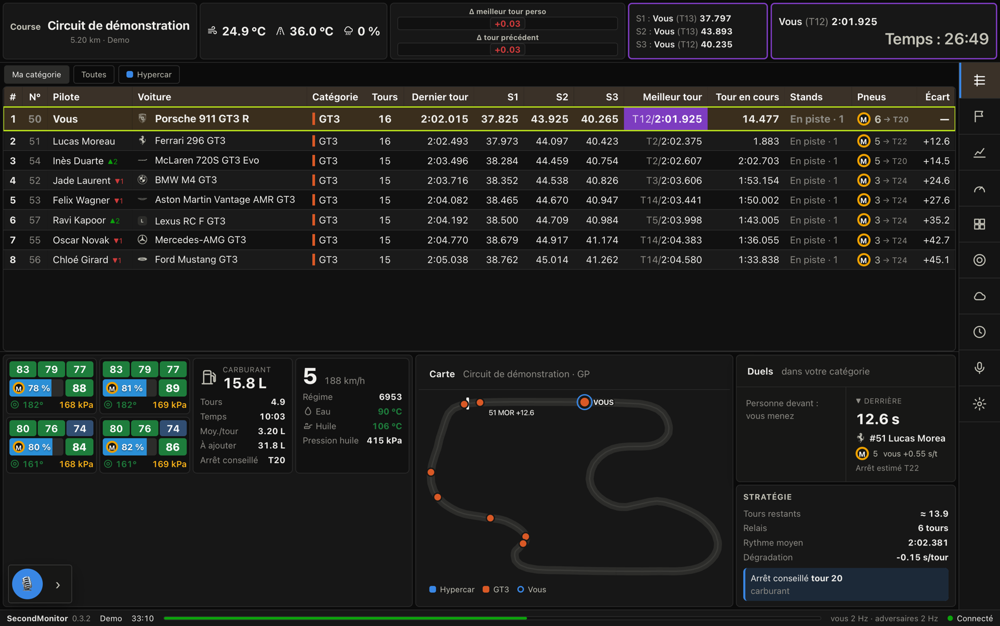

# SecondMonitor : chronométrage, stratégie et ingénieur de course IA sur un deuxième écran

[](https://github.com/OneDrop3D/SecondMonitor/actions/workflows/build.yml)
[](LICENSE)

Pendant que vous pilotez, SecondMonitor affiche sur un autre écran tout ce qu'un ingénieur de course regarde :
- le chronométrage complet (secteurs violets et verts, meilleurs tours, écarts) ;
- l'état de votre voiture (pneus, freins, carburant, moteur) ;
- la carte du circuit ;
- la stratégie et la météo ;
- un **ingénieur IA** qui vous parle à la radio.



> **Faut-il installer le SecondMonitor d'origine (celui de Matus Celko) ?**
> **Non.** Ce projet en est une nouvelle version complète et autonome. Il reprend son écran et ses connecteurs de jeux,
> et y ajoute les nouveautés. Installez seulement le fichier ci-dessous, rien d'autre (.NET est inclus).
> Si vous avez déjà l'ancien SecondMonitor sur le PC de jeu, fermez-le avant d'ouvrir le collecteur : ils utilisent le même port.

## Deux applications, installées ensemble

| Application | Où l'ouvrir | Ce qu'elle fait |
|---|---|---|
| **SecondMonitor** | Sur l'ordinateur qui **affiche** : un Mac, un PC portable, ou le PC de jeu lui-même sur un deuxième écran | Affiche le chronométrage, la voiture, la stratégie, la météo et l'ingénieur IA |
| **SecondMonitor Collecteur** | Sur le **PC de jeu** | Lit le jeu et envoie les données. Il tient dans une petite fenêtre et ne consomme presque rien |

Une seule installation met les **deux** applications sur l'ordinateur. Vous ouvrez celle qui correspond à son rôle.

```
   PC de jeu                                     Ordinateur qui affiche (ou le même PC, 2ᵉ écran)
 ┌────────────────────────────┐   réseau local  ┌─────────────────────────────────────┐
 │ jeu ─▶ SecondMonitor        │ ───────────────▶│ SecondMonitor                        │
 │        Collecteur           │                 │ chronométrage · stratégie · IA       │──▶ iPad / téléphone
 └────────────────────────────┘                 └─────────────────────────────────────┘    (navigateur, facultatif)
```

## Télécharger

Prenez le fichier de votre système dans les [**Releases**](https://github.com/OneDrop3D/SecondMonitor/releases) :

| Système | Fichier |
|---|---|
| **Windows** | `SecondMonitor-<version>-windows-x64-installation.exe` (installateur)<br>ou `SecondMonitor-<version>-windows-x64.zip` (sans installation) |
| **Mac** (Apple Silicon : M1, M2, M3, M4…) | `SecondMonitor-<version>-mac-arm64.dmg` |
| **Mac** (Intel) | `SecondMonitor-<version>-mac-x64.dmg` |
| **Linux**, SteamOS | `SecondMonitor-<version>-linux-x64.tar.gz` |

Les versions marquées « préversion » n'ont pas encore été essayées sur toutes les machines. Signalez les problèmes dans les [*Issues*](https://github.com/OneDrop3D/SecondMonitor/issues).

## Installer

### Windows
1. Lancez `SecondMonitor-…-installation.exe`. Windows peut afficher « Windows a protégé votre ordinateur » (l'application n'est pas signée par un éditeur payant) : cliquez **Informations complémentaires › Exécuter quand même**.
2. Choisissez ce que vous installez : les deux applications, seulement le collecteur (PC de jeu) ou seulement SecondMonitor.
3. Elles apparaissent dans le menu Démarrer : **SecondMonitor** et **SecondMonitor Collecteur**.

Au premier lancement du collecteur, Windows demande l'accès au réseau : choisissez **Réseau privé**.

### Mac
1. Ouvrez le `.dmg` et glissez **SecondMonitor** et **SecondMonitor Collecteur** dans *Applications*.
2. Au premier lancement, macOS peut bloquer l'application (elle n'est pas enregistrée auprès d'Apple). Allez dans *Réglages Système › Confidentialité et sécurité*, puis **Ouvrir quand même**.
   Si macOS dit qu'elle est endommagée : `xattr -dr com.apple.quarantine /Applications/SecondMonitor*.app`.
3. Acceptez l'accès au **réseau local** et, pour la radio, au **micro**.

Sur Mac, le collecteur sert aux jeux sur console (F1 et Forza envoient leurs données par le réseau).

### Linux / SteamOS
```sh
tar xzf SecondMonitor-*-linux-x64.tar.gz
./secondmonitor/installer.sh
```
Les deux applications s'ajoutent au menu. Leurs fenêtres utilisent WebKitGTK (`libwebkit2gtk-4.1`). S'il n'est pas installé,
SecondMonitor s'ouvre dans le navigateur et le collecteur dans un terminal. Le script indique la commande à taper.
Pour les jeux lancés avec Proton, voir [Collector/LISEZ-MOI.md](Collector/LISEZ-MOI.md).

## Démarrer

1. **Sur le PC de jeu**, ouvrez **SecondMonitor Collecteur**. Sa fenêtre montre :
   - si SecondMonitor est connecté ;
   - le jeu détecté ;
   - le débit envoyé ;
   - l'adresse du PC.

   Pour tester sans jeu, cochez *Démonstration*.
2. **Sur l'ordinateur qui affiche**, ouvrez **SecondMonitor**. Il trouve le collecteur tout seul sur le réseau local.
   Sinon, saisissez l'adresse du PC de jeu dans *Réglages*.
3. **Lancez une session** dans le jeu : le chronométrage se remplit.

**Un seul PC avec deux écrans** ? Ouvrez les deux applications sur ce PC et placez la fenêtre SecondMonitor sur le deuxième écran.
**Un iPad ou un téléphone** ? Ouvrez dans son navigateur l'adresse indiquée dans *Réglages* de SecondMonitor.

## Les écrans de SecondMonitor

L'écran d'accueil reprend celui de SecondMonitor d'origine. Les autres écrans sont dans la barre d'icônes à droite.

- **Chronométrage** :
  - en haut : session, météo, deltas en direct (meilleur tour, tour précédent), meilleurs secteurs, meilleur tour, temps restant ;
  - au centre : le tableau de chronométrage (dernier tour, S1/S2/S3 en violet ou vert, meilleur tour, tour en cours, stands, pneus, prochain arrêt estimé, écart) ;
  - en bas : les quatre pneus (surface, carcasse, usure, freins, pressions), le carburant, le moteur, la carte, les duels et la stratégie.
- **Classement & duels** : écarts, rythme, contact prévu avec la voiture devant ou derrière.
- **Tours & prévisions** : temps au tour de tous les pilotes, dégradation, projection du relais, carburant et usure à l'arrivée.
- **Vitesses & trajectoires** : Vmax et Vmin de tout le plateau, virage par virage, et trajectoires comparées.
- **Micro-secteurs** : 24 tronçons chronométrés, meilleur tour théorique.
- **Voiture** : températures et pressions détaillées, graphiques agrandissables, plages bleu / vert / rouge réglables par jeu et par voiture.
- **Météo** : historique et tendance pour les 30 minutes suivantes.
- **Stratégies** : relais et arrêts estimés de chaque pilote.
- **Ingénieur IA** et **Réglages**.

En course multi-catégories, le tableau montre votre catégorie et les autres voitures à moins de 5 s de vous. Le bouton *Toutes* affiche tout le plateau.

## L'ingénieur IA

- Il fonctionne **100 % en local** avec [Ollama](https://ollama.com), sans compte, sans abonnement et sans envoyer de données.
- Pour lui parler, utilisez le bouton radio de l'écran, la barre d'espace ou **un bouton du volant** : un appui pour parler, un appui pour envoyer. Un appui pendant qu'il parle le coupe.
- Les chiffres sont calculés par SecondMonitor : l'IA ne les invente pas.
- Il prend la parole de lui-même quand une décision se présente : pluie, relais à allonger, box dans deux tours, voiture qui revient, surchauffe…
- Il garde une **mémoire de la course** et on peut changer de modèle à la voix. Les modèles peuvent tourner sur plusieurs machines (un Raspberry Pi par exemple).
- Un **mode test** fonctionne sans jeu.

Mise en route : installez Ollama, téléchargez un modèle (`ollama pull lfm3-omni:2b`), puis choisissez-le dans l'écran *Ingénieur IA*.

## Jeux pris en charge

Le Mans Ultimate · Assetto Corsa Competizione · rFactor 2 · Assetto Corsa · Automobilista 2 · Project CARS 1 et 2 · RaceRoom ·
rFactor / Automobilista 1 · F1 2019, 2020, 2021, 24 · Forza Motorsport.

## Réseau et sécurité

- Tout reste sur votre réseau local. Le seul service extérieur est Ollama, sur vos propres machines.
- Ports utilisés :
  - `52642` en UDP, entre le collecteur et SecondMonitor (même protocole que le plugin « Data Broadcast Server » du SecondMonitor d'origine) ;
  - `8686`, pour l'interface en HTTP ;
  - `8687`, pour l'interface en HTTPS (micro et volant depuis un iPad ou un autre ordinateur).
- L'interface n'a pas de mot de passe : n'importe quel appareil de votre réseau local peut l'ouvrir. Utilisez-la chez vous ou derrière un VPN (Tailscale…), pas sur un Wi-Fi public.
- Le collecteur ne lit le jeu que lorsqu'un SecondMonitor est connecté. Il tourne en priorité basse : le jeu passe toujours avant lui.

## Construire

Tout se construit depuis un Mac avec le SDK .NET 10 (`brew install dotnet`) et Node.js 20 (`brew install node@20`) :

```sh
./construire.sh tous      # ou : mac, win, linux   →  fichiers dans dist/
```

L'installateur Windows `.exe` est fabriqué par [Inno Setup](https://jrsoftware.org/isinfo.php) sur Windows. Le workflow GitHub [build.yml](.github/workflows/build.yml) s'en charge.
Sans lui, `./construire.sh win` produit seulement le `.zip`.

- **OneDrop3D** : le produit *SecondMonitor* du Publieur lance ces mêmes commandes. Il change la version, envoie le code sur ce dépôt,
  fait construire sur GitHub et publie la release.
- **GitHub Actions** :
  - les tests tournent à chaque envoi ;
  - tous les systèmes sont construits sur chaque étiquette `v*` ou à la demande (*Actions › Construction › Run workflow*).

| Dossier | Contenu |
|---|---|
| `Hub/` | SecondMonitor (l'application qui affiche) : serveur .NET 10 et fenêtre (`src/`), interface React + TypeScript (`web/`), tests (`tests/`) |
| `Collector/` | SecondMonitor Collecteur. Voir [Collector/LISEZ-MOI.md](Collector/LISEZ-MOI.md). |
| `packaging/` | icônes, installateur Windows (Inno Setup), scripts d'installation Linux |
| `Connectors/`, `Foundation/`, `Remote/` | code du SecondMonitor d'origine, réutilisé sans modification |
| `Applications/`, `Telemetry/`, `Timing/`… | l'application Windows d'origine (WPF), gardée pour référence ; voir [docs/README-SecondMonitor-original.md](docs/README-SecondMonitor-original.md) |

```sh
dotnet test Hub/SecondMonitorHub.sln                                   # tests
cd Hub/web && npm install && npm run dev                               # interface en direct (relais vers le serveur)
dotnet run --project Hub/src/SecondMonitor.Hub -- --demo               # SecondMonitor avec la course de démonstration
dotnet run --project Collector/src -- --demo                           # collecteur qui envoie la démonstration
```

Options de SecondMonitor :
- `--navigateur` ouvre l'interface dans le navigateur au lieu de la fenêtre ;
- `--sans-fenetre` lance le serveur seul (machine sans écran, Raspberry Pi).

## Crédits et licence

- [SecondMonitor](https://gitlab.com/winzarten/SecondMonitor) © 2023 Matus Celko (winzarten), licence MIT : écran d'origine, connecteurs de jeux, modèle de données, protocole réseau.
- Nouvelle version (SecondMonitor multiplateforme, collecteur, ingénieur IA, analyses) © 2026 OneDrop3D, licence MIT.
- Logos des marques automobiles : [Simple Icons](https://simpleicons.org) (CC0). Les marques appartiennent à leurs propriétaires.

Voir [LICENSE](LICENSE).
