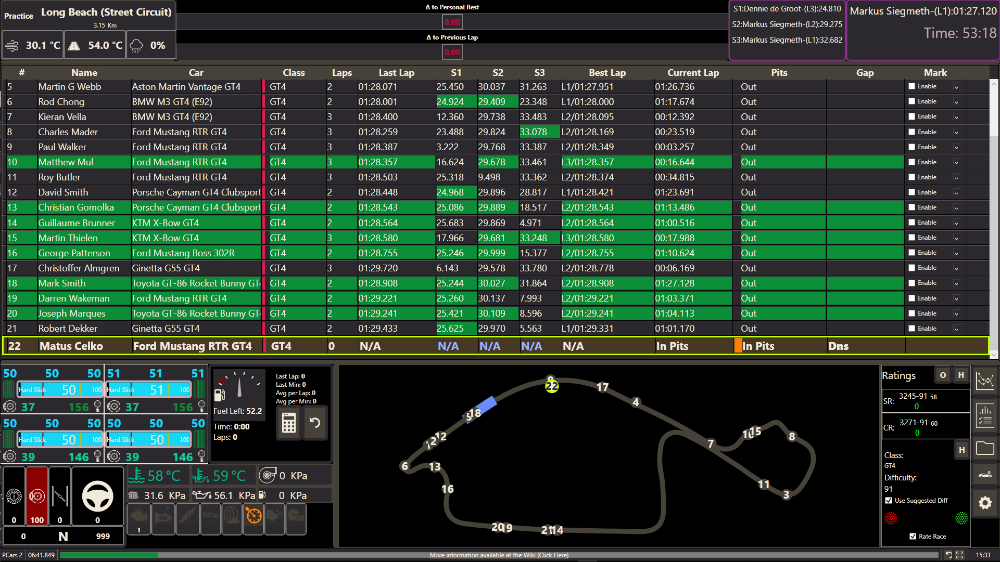
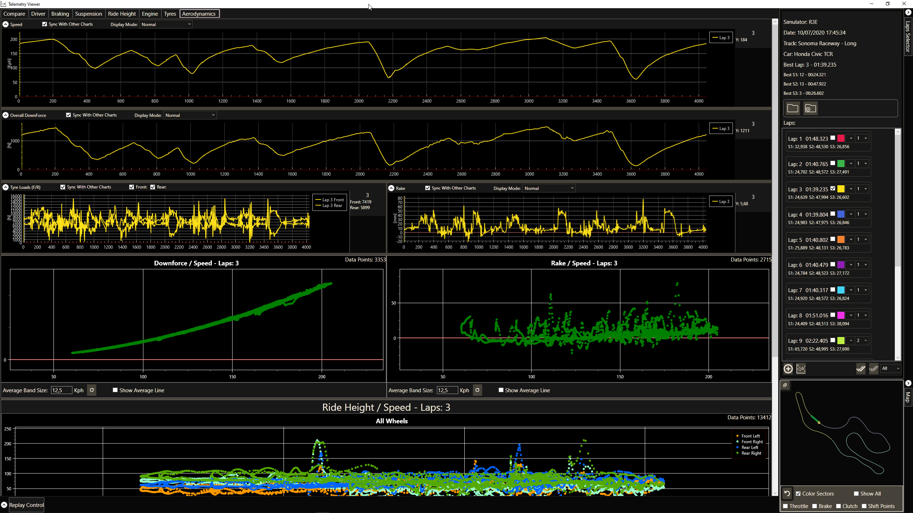

# Important

6.12. : If you have recent issues with second monitor _**crashing on startup**_, then please manuall install [the latest update](https://gitlab.com/winzarten/SecondMonitor/-/releases), there was an issue with the auto-update functionality.

# Second Monitor

Master: 

Project: 

## Installation

Check [release tab](https://gitlab.com/winzarten/SecondMonitor/-/releases) for latest version. Download the topmost .msi file.

**Requires .Net Core + ASP .NET Runtime, download** [here](https://dotnet.microsoft.com/en-us/download/dotnet/thank-you/runtime-aspnetcore-8.0.11-windows-hosting-bundle-installer).

## Wiki

[Wiki Manual](https://gitlab.com/winzarten/SecondMonitor/wikis/home)

## Introduction:

Second Monitor is Timing/Car information application for racing simulators. It displays the actual session information, timing information and basic car status idication.

**Information provided**:
* Session Information  
* Live timing  for each driver
* Pit information - in practice/qually it is a simple "in/out", in race it shows number of pit stops, and the last pit stop information  * Absolute/Relative driver ordering.
* Absolute/relative times 
* Live detla times between your current lap and previous + personal best
* Timing Circle (ellipse :D ) / Track Map: Position of cars on the track. The app needs one fully timed lap for to be able to show the track map. 
* Car Information - Brake temperatures, tyre temperatures + pressures, tyres condition, pedal and wheel postion, oil and water temperatures, pedals and wheel position.
* Fuel Monitor - Monitoring the current fuel levels and average consumption. Offering a quick color-coded information if the actual fuel state is enough to finish the session, and what is the required fuel delta.
* Fuel Calculator - Use consumption from previous/current session for required fuel calculation.  
* Detailed lap summer for each driver available by double-clicking on the driver name
* Session Reports - Ability to automatically export session reports in xlsx file. Files containig race summary, lap overview for each driver, race progress and detailed lap information for players laps
* **Rating** - Improve your single player experience using the [Rating Module](https://gitlab.com/winzarten/SecondMonitor/wikis/Rating-Tutorial)
* **SP Championships**  - New from v6.0, run SP championships in supported sims, with the ability to use templates from IRL series, both current and historic. [Championship overview](https://gitlab.com/winzarten/SecondMonitor/-/wikis/Championship-Overview)

**Using on another newtworked computer**

From version 4.0.0 it is possible to use Second Monitor on separate computer, than the sim is running on.
Check the [Instructions.](https://gitlab.com/winzarten/SecondMonitor/wikis/Setting-up-Second-Monitor-on-separate-computer) 
  
## Telemetry Viewer:
  

Telemetry Viewer allows to view and analyse the telemetry data that the main second monitor application captures during a session. The data are saved per completed lap and grouped into individual sessions. The basic usage of the application is explained in the topics below.

[See the Wiki](https://gitlab.com/winzarten/SecondMonitor/wikis/home)
  
## Supported Simulators
* **R3E** - Works out of the box
* **Automobilista** - Requires the rFactorSharedMemoryMapPlugin (https://github.com/dallongo/rFactorSharedMemoryMap). Can be automaticaly installed by the app. This is the same plugin that is used (and automatically installed) by CrewChief, so if you're using that, you're good to go.
* **Automobilista 2** - Works out of the box. Just be sure to enable both, the shared memory, inside AMS 2 settings, in Project Cars 2 format.
* **RFactor 1** - Same as Automobilista. Wasn't tested, but it is the same engine as AMS, and the same plugin is used for data, so it should work.
* **RFactor 2** - Requires the rF2SharedMemoryMapPlugin (https://github.com/TheIronWolfModding/rF2SharedMemoryMapPlugin). Can be automaticaly installed by the app. This is the same plugin that is used (and automatically installed) by CrewChief, so if you're using that, you're good to go.
* **Assetto Corsa** - Requires custom plugin, than should be automatically installed when the app detect Assetto Corsa running. The plugin needs to be enabled in the options settings manualy. Manual installation instruction can be found [here.](https://gitlab.com/winzarten/SecondMonitor/-/wikis/Manual-Plugin-Installation) 
* **Assetto Corsa Competizione** - Requires that the broadcast server of ACC is enabled. Follow the PRELIMINARY STEPS in the following link https://www.assettocorsa.net/forum/index.php?threads/accdirector-v1-0-0-broadcast-client.57202/
* **Project Cars 2** - Works out of the box. Just be sure to enable both, the shared memory, and the UDP data, inside Project Cars 2 [options](http://www.eksimracing.com/f-a-q/configure-project-cars-to-use-shared-memory/)
* **Project Cars** - Limited functionality as split times and lap times are not provided by the sim api. Splits don't work at all, and lap timing is done by the app, so the will be slight difference between what is in the app and what is in sim. Big thanks to mr_belowski for allowing me to use his project cars pit coordinates from CrewChief :)
* **F1 2019** - Requires the telemetry UDP output to be enabled in the game (open options menu from the main menu, then enter the settings menu - the UDP option will be at the bottom of the list. ).
* **F1 2020** - Requires the telemetry UDP output to be enabled in the game (open options menu from the main menu, then enter the settings menu - the UDP option will be at the bottom of the list. ).
* **F1 2021** - Requires the telemetry UDP output to be enabled in the game.
* **F1 2024** - Requires the telemetry UDP output to be enabled in the game.
* **Le Mans Ultimate** - Requires the rF2SharedMemoryMapPlugin (https://github.com/TheIronWolfModding/rF2SharedMemoryMapPlugin). Can be automaticaly installed by the app. This is the same plugin that is used (and automatically installed) by CrewChief and Simhub, so if you're using one of those, you're good to go.
* **Forza Motosport** - Use the plugin manager to define the port, Forza needs to setup to the 'dash' packet type output. Forza provides only very basic information, so the functionality is very limited for this game.

### Donate
Supporting this application helps me fund the coffee supply required for continous development :)

## Known Issues
[Known Issues - Second Monitor](https://gitlab.com/Winzarten/SecondMonitor/wikis/Known-Issues)

[Known Issues - Telemetry Viewer](https://gitlab.com/Winzarten/SecondMonitor/wikis/Known-Issues-(Telemetry-Viewer))

[Issues Tracker](https://gitlab.com/winzarten/SecondMonitor/issues) 

## Future Plans   
 - [ ] Basic setup "sanity check"
 
 
## Support

For Support please use the application topic on r3e forums : https://forum.sector3studios.com/index.php?threads/secondmonitor-timing-status-app.9587/

## Installation

Check [release tab](https://gitlab.com/winzarten/SecondMonitor/-/releases) for latest version. Download the topmost .msi file.

Developed using JetBrains Rider 

